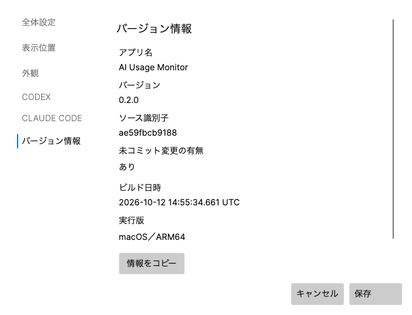

# バージョン情報実装・検証記録（2026-10-13 JST）

AI Usage Monitorの設定に「バージョン情報」を実装し、ローカルテスト・ビルドまで完了した。初回検証時点ではcommit、push、PR、公開、インストール済みアプリの置換は実施していなかった。その後の利用者依頼による置換・起動は末尾の追補に記録した。

## 確認した構成と変更

- 対象は独立した`ai-usage-monitor`リポジトリ。変更前の製品バージョンは0.1.0。今回の機能追加は0.2.0とした。
- .NET 10（SDK 10.0.204）／Avalonia 12.1.2。Windows 11 x64・ARM64、macOS ARM64のホストと共通UIがあり、Windowsでは旧WPF版も明示選択できる。今回の実行環境はmacOS 27.0.1 ARM64。
- 既存の定義元`Directory.Build.props`を使用し、macOSの重複した固定値を除去。Core、ホスト、設定、配布JSON、macOS bundle metadata、Windows EXEの製品バージョンを一致させた。
- `Directory.Build.targets`でGit短縮ID、変更有無、UTCビルド日時を生成し、`ProductBuildInfo`が埋め込みJSONだけから読めるようにした。Git失敗時は不明。実行版は実行中プロセスのOS／アーキテクチャを表示する。
- AvaloniaとWPFの設定に、指定順の6項目と「情報をコピー」を追加。同じモデルから画面とコピー文を生成する。オンライン更新判定や自動更新、新しい本番依存は追加していない。
- 通常のpublish/rebuild入口を維持。macOSはInfo.plistとbundle-manifest.jsonの版を配布JSONから取得する。`publish --no-build`では既存の埋め込み日時を保持する。
- 既存のClaude関連変更はファイルハッシュで保持を確認。READMEの既存内容も原文比較で保持を確認した。

版の更新規則は[バージョン管理](../versioning.md)へ記載した。機能追加minor、修正patch、互換性を壊す変更major。0.xでも破壊的変更はmajorとして1.0.0以上へ更新し、安定版への判断でも1.0.0へ移行できる。同じリリースは全OS／アーキテクチャで同一番号とし、再ビルドだけでは更新しない。

## テストと検証

| 検証 | 結果 |
| --- | --- |
| `pwsh -NoProfile -File scripts/test-ai-usage-monitor-macos.ps1 -Coverage` | 719 tests PASS、native stdio／PTY／署名／socket検証PASS、ビルド警告0・エラー0 |
| production coverage | 94.20%（7,169/7,610）、未計測0、90% gate PASS |
| `pwsh -NoProfile -File scripts/test-version-info-contract.ps1`（最終版） | 18 snapshots PASS。Gitなし、取得失敗、変更ありなし、3 RID、再ビルド、NoBuild保持 |
| Core unit tests | 埋め込み情報とアセンブリ版・配布JSONの一致、名称・順序、UTC・文化非依存、変更ありなし不明を確認 |
| Avalonia headless tests | 設定の版表示、コピー全文一致、保存を伴わない操作、最小サイズでの描画を確認 |
| `pwsh -NoProfile -File scripts/format.ps1 -Check -ProjectPath .` | PASS |
| `pwsh -NoProfile -File scripts/lint.ps1 -Mode Fast -ProjectPath .` | PASS |
| WPF変更C#の`dotnet format whitespace --folder --verify-no-changes --include ...` | PASS |
| WPF test projectの`dotnet build ... -c Release -p:EnableWindowsTargeting=true` | XAML・C#・テストコードのクロスビルドPASS、警告0・エラー0。Windowsでのテスト実行は未実施 |
| 実際の`dotnet publish --no-build` | 配布JSONと埋め込みJSONのバイト一致PASS |
| リポジトリ外でのCore読取り | Git不在、配布JSON不在、ソースツリー不在でも版と6項目を読取りPASS |
| 最終成果物の照合 | 埋め込みJSON・配布JSONのバイト一致、表示・コピー一致、Windows単一EXE内のCoreバイト一致、PE Machine・version resource一致、macOS metadataと251ファイルのSHA-256一致。PDB同梱なし |

標準テスト後の変更は、Git失敗時のMSBuild条件、NoBuild保持、WPF clipboardの型明確化とWPFテスト追加、macOS配布のdebug symbol除外。変更に対応して18件の生成契約、NoBuild実publish、WPFコンパイル、3種の最終publishと埋め込み照合を実行した。既に通った共通C#の719テストは、その後変更していない。



画像はアカウント情報を含まないheadless fixtureの画面であり、最終配布物のnative UI受入を表すものではない。日時はこのfixtureをコンパイルした時刻を示す。

## 最終ビルド

ローカルpublishの出力は`artifacts/internal-test-readiness-blocked-version-info-final/`。WindowsはmacOSから`EnableWindowsTargeting=true`を設定して既存のpublishスクリプトを実行した。macOSは既存のmacOS publishスクリプトで新規`.app`を生成した。

| RID | 製品バージョン | ソース識別子 | 変更有無 | ビルド日時（UTC） |
| --- | --- | --- | --- | --- |
| osx-arm64 | 0.2.0 | ae59fbcb9188 | あり | 2026-10-12T15:08:02.3044640+00:00 |
| win-x64 | 0.2.0 | ae59fbcb9188 | あり | 2026-10-12T15:08:15.8547720+00:00 |
| win-arm64 | 0.2.0 | ae59fbcb9188 | あり | 2026-10-12T15:08:19.1926280+00:00 |

- macOS: `macos/AI Usage Monitor.app`。Mach-O ARM64、ad-hoc署名・strict verify PASS。CFBundleVersion／CFBundleShortVersionString／ホストProductVersionは0.2.0。
- Windows: `AiUsageMonitorBuilds/win-x64/AiUsageMonitor.App.exe`と`AiUsageMonitorBuilds/win-arm64/AiUsageMonitor.App.exe`。PE Machineはそれぞれ0x8664、0xaa64。ProductNameはAI Usage Monitor、ProductVersionは0.2.0、FileVersionは.NETの4桁形式0.2.0.0。
- 詳細なローカルQA記録は`.work/version-info/`へ保持した（生成物・source管理対象外）。ビルドログ、最終照合JSON、既存変更のhash baseline、独立読取り結果、検証スクリプトを含む。

## 未検証

Windows x64／ARM64でのnative起動、設定画面・OS clipboard、WPF testsの実行、ARM64 PC上でのx64エミュレーション表示は未検証。macOS最終`.app`は下記追補でデモモードのnative起動・設定画面・実クリップボードを検証済み。通常モードでのprovider接続、実アカウント、設定保存、Gatekeeperの受入は行っていない。macOS x64やLinuxは現在の配布対象に含まない。

成果物はローカルQA用であり、実機受入や公開の承認を意味しない。


## 実機UI・クリップボード追補（2026-10-13 JST）

利用者の実機確認依頼に従い、最終macOS配布物を`--demo`で実行した。これは同じAvalonia設定画面とmacOS clipboardを使うnative起動であり、headlessではない。既存の設定は読み書きせず、実CLIには接続しない。開始時のインストール済み常駐版はPID 361、検証版はPID 50045だった。

1. 検証版のメニューバーを開き、「設定…」から実際の設定ウィンドウを開いた。
2. 同名プロセスのUI参照の混同を避け、AXUIElementCreateApplicationで検証版PIDに直接結び付けた。タブとボタンはAXで位置を確認し、CGEventのマウスクリックで操作した。
3. 「バージョン情報」に指定順で次の表示が存在し、配布JSONと一致することをAXの実ウィンドウから確認した。

```text
アプリ名: AI Usage Monitor
バージョン: 0.2.0
ソース識別子: ae59fbcb9188
未コミット変更の有無: あり
ビルド日時: 2026-10-12 15:08:02.304 UTC
実行版: macOS／ARM64
```

4. 「情報をコピー」を実クリックし、「情報をコピーしました。」が表示されたことを確認した。
5. macOSのNSPasteboard更新番号が98から99へ増加した後に、新しくコピーされた文字列だけを取得した。コピー全文は上記6行と完全一致し、検証版が終了した後もクリップボードへ残ることを確認した。元のクリップボード内容は取得していない。
6. 画面収録権限がないためウィンドウ画像の保存はできなかった（CGPreflightScreenCaptureAccess=false）。代わりに、対象PIDだけのAX表示値、コピー結果、照合JSONを`.work/version-info/native-*`へ保持した。

判定: **バージョン情報表示／実クリップボードへのコピーはPASS**。アプリのソース変更・再ビルド・インストール済みアプリの置換・commit・push・公開は行っていない。

終了確認時には検証版と開始時の旧常駐版の両PIDが終了状態だった。旧版への終了命令は送っておらず、旧版の終了理由は確認できていない。検証版に終了操作を行おうとした時点で設定ウィンドウが既になく、通常の終了メニュー操作には到達していない。旧版は自動再起動していない。インストール済み実行ファイルの更新日時は検証開始より前のままである。


## インストール済みMac版の更新・通常起動（2026-10-13 JST）

利用者の「このPCのインストール済みMac版を、今回ビルドした0.2.0に更新して起動してください」という明示依頼に基づき、`~/Applications/AI Usage Monitor.app`を更新した。

- 0.2.0の元成果物・staging・インストール後の全251ファイルをSHA-256で照合し、deep／strict署名検証を実施した。
- 旧0.1.0は`artifacts/installed-backups/ai-usage-monitor-0.1.0-20261012T154010Z/AI Usage Monitor.app`へ完全退避し、元の全ファイル・mode・symlinkとの一致を検証した。旧版は削除していない。
- 新版のstaging検証後に旧版を退避し、新版を元のインストール先へ移した。途中で失敗した場合に旧版を戻す処理を備えて実行した。
- `open -n`でインストール先の新版を**通常モード（--demoなし）**で起動した。起動イベント`started`、例外なし、インストール先の本体PID 54177とhelperの起動を確認した。
- 通常モードの「設定…」→「バージョン情報」を開き、実ウィンドウの指定6項目が配布JSONと一致することを確認した。0.2.0、ae59fbcb9188、変更あり、2026-10-12 15:08:02.304 UTC、macOS／ARM64が表示されている。
- 新版は起動したまま引き渡した。ユーザー設定の直接編集、CLI設定編集、認証情報の取得、commit、push、PR、公開は行っていない。

ロールバックする場合は新版を通常終了し、新版を未使用の退避先へ移してから、上記backupの`.app`を`~/Applications/AI Usage Monitor.app`へ戻して起動する。今回、ロールバックは実行していない。

インストールと通常起動はPASS。providerの利用状況や実アカウントの機能受入、設定保存、Windowsの実機受入は、この更新依頼では追加検証していない。詳細receiptと実機AX表示値は`.work/version-info/install-macos-0.2.0.json`、`.work/version-info/installed-native-version-ui.json`へ保持した。
